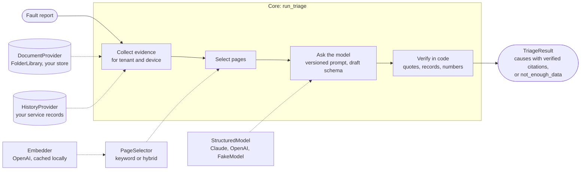

# machine-fault-triage

Evidence-grounded fault triage for field service: heat pumps, HVAC, agricultural machinery.

Given a fault report, the device's manuals and its service history, the library returns a structured hint for the technician: probable causes, checks to run, the likely fix and parts to bring. Every cause points to a verified quote from a manual page or to a past service record. When the evidence is missing, the result says so instead of guessing.

> **Status: pre-alpha.** What exists: a one-call pipeline with citation verification, PDF loading, keyword and hybrid page selection, an evaluation harness, and adapters for Claude and OpenAI. No results are published yet, because the seed cases were written with the help of a model.

## Why

A technician usually learns what is wrong only after arriving on site, although the error code, the manual page that explains it and last spring's identical repair already exist. Generating a plausible answer from them is easy. Knowing when the answer is supported is the hard part, and the design is built around it:

- **Grounded or flagged.** The model answers in a draft schema that has no `verified` field. The library checks every quote against the cited page, as whole words and at least three of them, and every service record against the supplied history. A cause without verified evidence drops to low confidence, and numbers in the answer that occur nowhere in the evidence are listed in `unsupported_figures` ([ADR 0001](docs/adr/0001-verify-citations-outside-the-model.md)).
- **Abstention is a result.** `not_enough_data` with questions for the customer is a first-class outcome.
- **Bounded and explained.** Inputs and the answer schema have size limits, an answer that breaks the schema is asked for again once, and a failed run names the fields that broke it.
- **Untrusted input stays data.** Fault reports and document text reach the model only as `UntrustedBlock` values, apart from the instructions.
- **Bring your own model and storage.** `StructuredModel`, `Embedder`, `DocumentProvider` and `HistoryProvider` are `typing.Protocol` interfaces. The core depends on no provider SDK.

## Architecture

One call, `run_triage`, runs a fixed pipeline. Everything that touches the outside world sits behind a port, so the core has no provider SDK, no database and no network code.



| Step | What happens | Where |
| --- | --- | --- |
| Collect | Documents and service records of one tenant and device; superseded editions are left out | `ports.py`, `folder.py`, `pdf.py` |
| Select | Optional: keep the pages that match the report by wording (BM25) or also by meaning | `selection.py`, `embeddings.py` |
| Ask | Instructions and untrusted evidence go to the model separately; the answer is a draft with no `verified` field | `prompts.py`, `adapters/` |
| Verify | Quotes are checked against the pages sent, records against the history, numbers against the evidence | `grounding.py`, `pipeline.py` |
| Measure | The same pipeline runs over a dataset; metrics are computed in code | `evals/` |

## Quickstart

Runs offline: `FakeModel` returns a scripted draft, and the library verifies it.

```python
from machine_fault_triage import Document, FaultReport, Page, ServiceRecord, run_triage
from machine_fault_triage.drafts import (
    DraftCause,
    DraftDocumentCitation,
    DraftHistoryCitation,
    DraftTriage,
)
from machine_fault_triage.models import Confidence
from machine_fault_triage.testing import FakeModel

manual = Document(
    id="service-manual",
    title="AquaHeat 12 service manual",
    pages=(Page(number=77, text="7.3 Error codes\nE7: flow sensor open or short circuit"),),
)


class Evidence:
    def documents_for(self, *, tenant_id: str, device_id: str) -> list[Document]:
        return [manual]

    def records_for(self, *, tenant_id: str, device_id: str) -> list[ServiceRecord]:
        return []


model = FakeModel(
    [
        DraftTriage(
            summary="E7 points to the flow sensor.",
            enough_evidence=True,
            causes=(
                DraftCause(
                    title="Flow sensor fault",
                    confidence=Confidence.HIGH,
                    why="The manual maps E7 to the flow sensor.",
                    citations=(
                        DraftDocumentCitation(
                            document_id="service-manual",
                            page=77,
                            quote="E7: flow sensor open or short circuit",
                        ),
                        DraftHistoryCitation(record_id="order-404"),
                    ),
                ),
            ),
        )
    ]
)

result = run_triage(
    FaultReport(description="Display shows E7, no heating.", language="en"),
    tenant_id="acme",
    device_id="heat-pump-17",
    model=model,
    documents=Evidence(),
    history=Evidence(),
)

citation = result.causes[0].citations[0]
print(result.evidence_level, citation.document_title, citation.page, citation.verified)
```

```text
manual AquaHeat 12 service manual 77 True
```

The quote is on page 77, so the citation is verified. The cited service record `order-404` was never supplied, so that citation is dropped.

## Usage and cost

Every result says what the run spent, so the calling application can log it per tenant and device and price it at its own rates. Budgets, alerts and dashboards belong to that application, not to the library.

```python
usage = result.usage
if usage is not None:
    print(usage.input_tokens, usage.cached_input_tokens, usage.output_tokens)
print(result.embedding_tokens)
```

```text
0
```

`usage` is `None` when the model adapter reports no tokens, as `FakeModel` does here. It is set for refused and truncated calls too, which are billed, and totals every attempt when an answer was asked for again (`result.attempts`). `cached_input_tokens` is the part of the input that the provider read from its prompt cache. `embedding_tokens` counts the fault report and the pages embedded for the first time; pages in the vector cache cost nothing.

## Evaluation

Changes to prompts, models or page selection are judged on a dataset, with metrics computed in code: answering or abstaining as the evidence allows, the expected top cause, the expected page sent and cited, retrieval on its own (recall, precision, reciprocal rank, NDCG), the share of citations that verify, resistance to prompt injection, and safety warnings ([ADR 0002](docs/adr/0002-score-evaluations-in-code.md)). Prompts are versioned and old versions stay runnable ([docs/prompts.md](docs/prompts.md)).

```bash
uv sync --all-extras
uv run machine-fault-triage eval run --dataset datasets/seed \
    --model machine_fault_triage.adapters.claude:ClaudeModel \
    --option model=claude-sonnet-5-5 --repeats 3 --out runs/sonnet.json
uv run machine-fault-triage eval compare runs/baseline.json runs/sonnet.json
```

`--model` takes any `module:callable` that returns a `StructuredModel`; the `anthropic` and `openai` extras ship adapters that read credentials from the environment and call paid APIs. `--pages N` sends only the best-matching pages, by wording or, with `--embedder`, also by meaning; `--prompt N` runs an older prompt; `--price`, `--cached-price` and `--embedding-price` add cost to the report. [`datasets/seed`](datasets/seed) holds two fictional devices and eighteen cases, three of them prompt-injection attempts: a first signal, too small to rank models that are close.

## Limitations

- Verification proves that a quote exists on the page, not that it supports the cause.
- `evidence_limit` and `report_limit` count characters, not tokens. The default of the first suits models with a large context window; set both for the models in use.
- Checks, fixes and parts are free text. Only their numbers are compared with the evidence.
- Quotes must be literal; a two-word table cell or text with OCR errors does not verify.
- Top-cause accuracy is a keyword match, a proxy that a judging model will later complement.
- `KeywordPageSelector` is lexical: a report in another language than the manual, or in other words, can miss the right page. `HybridPageSelector` also matches by meaning, at the price of an embedding call per report, and still misses pages. Selected pages are not reranked.
- An evaluation run ranks the pages a second time for the retrieval metrics; the embedding tokens of that second pass are not counted. The first triage after a new manual pays for embedding its pages, because `library sync` does not embed.
- The Claude adapter does not use prompt caching yet, so its `cached_input_tokens` is zero in practice.
- The unit of evidence is the page. Ranking by smaller pieces (`--chunk-size`, the `chunking` extra) is optional and off by default: on the one real manual it was tried on, it changed the retrieval metrics by no more than the noise between cases.
- `FolderLibrary` is the only ready-made document source. It syncs on request, not on a schedule, and has no access control beyond the tenant and device folders.
- PDFs need a text layer; scanned manuals are rejected, not recognized.

## Roadmap

1. Hand-written cases and a first published baseline: accuracy, cost and latency
2. A reranker over the selected pages
3. A judging model for whether a quote supports its cause
4. Tool-using agent variant, compared against the fixed pipeline
5. Postgres adapter and full evaluation report

## Development

```bash
uv sync --all-extras
uv run ruff format --check && uv run ruff check && uv run mypy && uv run pytest --cov
```

See [CONTRIBUTING.md](CONTRIBUTING.md) for conventions. Licensed under [Apache-2.0](LICENSE).
