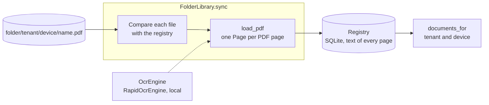
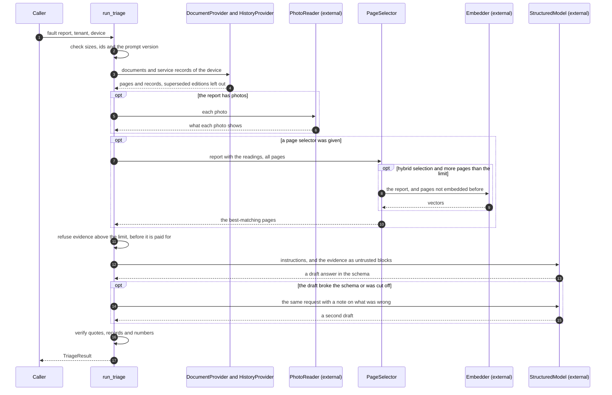
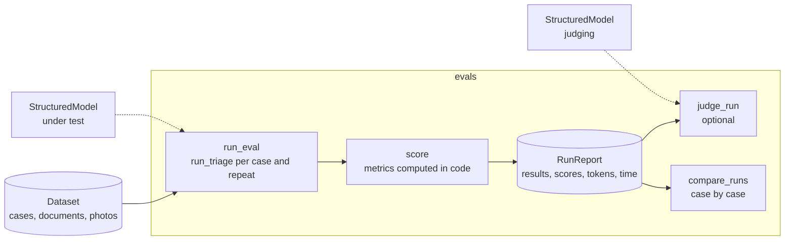

# Architecture

The library has three flows. Manuals are read into a registry ahead of time, one fault report is answered in one call of `run_triage`, and an evaluation runs that same call over a dataset. The core imports no provider SDK: every model, embedder, recognition engine and store is reached through a `typing.Protocol` in `ports.py`.

In the diagrams a dashed arrow is a call through a port, and a box marked *external* sends data to a provider outside the process when the shipped adapter is used.

## Reading the manuals

- A file is read again when its content changed, when `load_pdf` changed how it extracts text, or when the recognition engine changed. A file that cannot be read is reported and does not stop the others, and the version read earlier stays in use.
- A page with a text layer is never recognised. A page without one is left out unless an `OcrEngine` is given, and then it is marked `source="ocr"`, a mark that follows it into every citation.
- The tenant and the device come from the folder names and are looked up by equality. `documents_for` answers from the registry alone, so a triage run never parses a PDF.
- A sync embeds nothing. Page vectors are made by the first triage that needs them and kept by `CachedEmbedder` in a second SQLite file, under the embedding model and a hash of the page text.

## Answering one fault report

| Step | Goes in | Comes out | What can go wrong, and what then |
| --- | --- | --- | --- |
| Checks | The report, the ids, the limits | Nothing | A blank id, a report above `report_limit`, photos without a reader, an unknown prompt version: `InvalidRequestError` before any call is paid for |
| Collect | Tenant and device | Documents and service records | Two documents or two records share an id: `InvalidRequestError`, because a citation could not tell them apart. An old edition next to its replacement is left out |
| Read photos | Each photo of the report | One text per photo | The reader misreads a code: nothing detects it, and the quotes then verify for the wrong code. The readings are returned in `photo_readings` for a person to compare |
| Select pages | The report with the readings, every page | At most `limit` pages | The right page is not among them: the answer cannot quote it. Measured in evaluation as `expected_page_sent` and the retrieval metrics |
| Ask | Instructions, apart from the evidence in tagged blocks | A draft with no `verified` field | A refusal is final and ends as `refused`. A draft that breaks the schema or is cut off is asked for again, `retries` times, then ends as `failed` with the fields that broke it. The API cannot be reached: `ModelCallError` |
| Verify | The draft, and exactly the pages and records that were sent | Causes with `verified` set on each citation | A quote that is not on its page stays in the result, unverified. A cause without verified evidence drops to low confidence. Numbers found nowhere in the evidence are listed in `unsupported_figures` |

The result always carries the tokens the run spent: `usage` for the model, every attempt included, `embedding_tokens` for page selection and `photo_usage` for the reader.

### What verification does and does not prove

- A quote counts when it holds at least three words and occurs on the cited page as whole words. A quote of five words or more that stands on another page of the same document is moved to the nearest such page, and `cited_page` keeps the number the model gave ([ADR 0001](adr/0001-verify-citations-outside-the-model.md)).
- A service record counts when its id is among the records supplied.
- `evidence_level` names the strongest verified evidence: a manual, the history, or general knowledge when no citation verified.
- A model that says the evidence is not enough, or names no cause, ends as `not_enough_data` with its questions for the customer.
- Verification proves that the quote exists. It does not prove that the quote supports the cause, that a table row belongs to the right model of the device, or that a photo was read correctly. The first two are measured in evaluation only.

### What leaves the process

The core sends nothing anywhere. With the shipped adapters, the fault report, what was read from its photos, the device model, the selected pages and the service records go to the provider of the model; the photos as given, metadata included, go to the provider of the reader; the report and the text of pages not embedded before go to the provider of the embedder. `RapidOcrEngine`, the registry and the vector cache stay on the machine.

Every piece of evidence reaches the model as an `UntrustedBlock`, apart from the instructions and wrapped by the adapter in tags that its text cannot forge ([prompts.md](prompts.md)).

## Evaluating a change

- A case holds a fault report, the documents and records supplied with it, and what a correct result looks like: the status, the terms of the expected cause, the pages it must quote. The loader rejects a case whose expected evidence is not in what it supplies.
- `run_eval` calls `run_triage` for every case, `repeats` times, because models offer no deterministic mode. Sizes and photos of all cases are checked before the first paid call.
- Every metric but one is computed in code from the result ([ADR 0002](adr/0002-score-evaluations-in-code.md)). `quote_supports_cause` is the opinion of a judging model, added to a finished report by `eval judge` and kept apart from the rest.
- A report records the digest of the dataset, the prompt version, the page selection, the photo reader and the judge, so that a comparison can say when two runs are not like for like.

## Modules

| Module | Holds |
| --- | --- |
| `inputs.py`, `models.py`, `drafts.py` | What goes in, what comes out, and the schema the model answers in |
| `ports.py` | The protocols: `StructuredModel`, `PhotoReader`, `PageSelector`, `Embedder`, `OcrEngine`, `DocumentProvider`, `HistoryProvider`, `TextSplitter`, `PageRanker` |
| `pipeline.py` | `run_triage` |
| `grounding.py` | Verification of quotes, records and numbers |
| `selection.py`, `embeddings.py` | Keyword and hybrid page selection, the vector cache |
| `pdf.py`, `folder.py` | PDF loading and the folder of manuals with its registry |
| `prompts.py` | Versioned instructions |
| `render.py` | A result as plain text for a technician |
| `adapters/` | Claude, OpenAI, RapidOCR and Chonkie behind the ports; each needs its extra |
| `evals/` | Cases, the runner, scoring, reports, the judge and comparison |
| `testing.py` | `FakeModel` and other stand-ins that run offline |
| `cli.py` | `library sync`, `eval run`, `eval judge`, `eval compare` |
